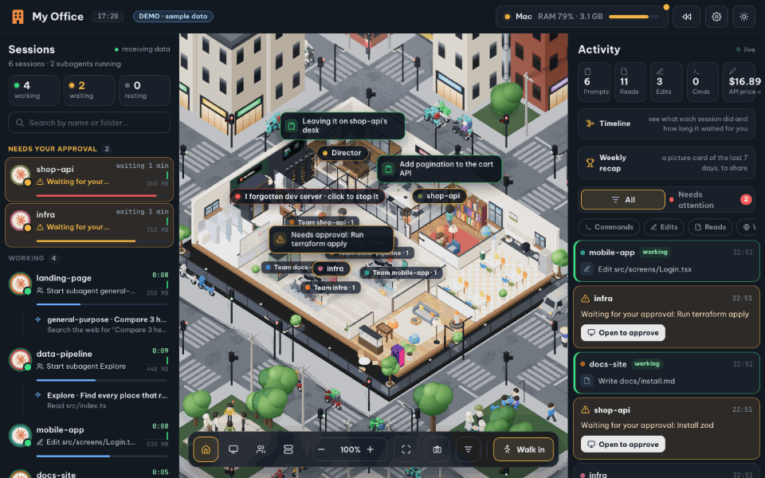

# 🏢 MyOffice-W-Antigravity — 3D Multi-Agent Office & Web IDE for Google Antigravity & Claude Code

[](LICENSE)
[](package.json)
[](package.json)

[Tiếng Việt](README.md) · **English** · [Architecture](docs/ARCHITECTURE.md) · [Security](SECURITY.md) · [Contributing](CONTRIBUTING.md)

**MyOffice-W-Antigravity** is a real-time interactive 3D office and integrated **Antigravity Web IDE** (Three.js + Next.js + Node.js SSE Server + Rust Native Engine) where your **Google Antigravity** and **Claude Code** sessions come to work as 3D Chibi characters at their own desks: walking to the library to read files, typing code at their desks, visiting the server room to run terminal commands, spawning **Subagent** teammates connected by visual team lines, surfacing `implementation_plan.md` / `ask_question` prompts in a centered **Focus-to-Approve** modal, and celebrating completed tasks.



---

## 🙏 Original Author & Attribution

This project is built upon and extends the open-source project **[My Office (`khanh020905/my-office`)](https://github.com/khanh020905/my-office)**:

- **Original Author**: **[@khanh020905](https://github.com/khanh020905)**
- **Original Repository**: **[https://github.com/khanh020905/my-office](https://github.com/khanh020905/my-office)** (*"Văn phòng 3D cho các phiên Claude Code · A 3D office for your Claude Code sessions"*)
- **Google Antigravity Adaptation & Multi-Agent Architecture (`MyOffice-W-Antigravity`)**: **[@Kettailor](https://github.com/Kettailor)** — added the real-time `Antigravity Brain Watcher` (`server/antigravity.mjs`), the built-in **Antigravity Web IDE** (`/antigravity`), the **Rust Native Engine** (`rust-native/`) & **Docker On-Demand Host Bridge** (`server/host-bridge.mjs`), the **16-Desk 4-Pod Layout + Overflow Hot-desks**, **Focus-to-Approve** modal for `ask_question` and `implementation_plan.md` feedback, **4-Tab MCP Hub** (`server/mcp.mjs`), **Project File Manager & `.docx`/`.xlsx`/`.pdf` Viewer** (`server/files.mjs`), **Task Dispatch (`📋 Give Work` with 14-model selector, 20-photo drafts, inline session rename/pin) & 2-Channel Group Chat (`💼 Work` vs `💬 Watercooler`)**, **Dual 5h/7d Quota gauges (Gemini Ultra vs Claude/GPT)**, Windows NVIDIA GPU monitoring, and **SHA-256/HMAC** role-based remote access control (**Deputy Director 6-digit PIN** vs. **Assistant Director** workspace-scoped access in `server/access.mjs`).
- **Additional Credits**:
  - Runaway CPU/RAM and forgotten dev-server heuristics in `server/system.mjs` adapted from [Kanevry/cc-reaper](https://github.com/Kanevry/cc-reaper) (Apache-2.0).
  - Street vehicles built from [Kenney Car Kit 3.1](https://kenney.nl/assets/car-kit) (CC0).

> **Note**: This is an independent community project and is not affiliated with or endorsed by Google or Anthropic.

---

## ✨ Key Features

1. **Zero-Config Google Antigravity `Brain Watcher` (`server/antigravity.mjs`)**
   - Automatically watches `~/.gemini/antigravity/brain/<conversation-id>/.system_generated/logs/transcript.jsonl` (and hydrates truncated steps from `transcript_full.jsonl`).
   - **16-Desk 4-Pod Floor Plan & Overflow Hot-desks**: Supports 16 primary desks across 4 pods plus dynamic overflow seating in the meeting room, dining table, and library when more than 16 active sessions are running.
   - **Focus Mode Power Saving**: Automatically caps WebGL rendering to `12 FPS` and throttles secondary background animations while full-screen management panels are open.

2. **Built-in Antigravity Web IDE (`/antigravity`)**
   - Dedicated full-screen web workspace synced in real time with all active Antigravity conversations.
   - **Rich Conversation Turns**: Inspect user prompts, attached media, expandable reasoning steps (`Thinking`), tool executions, and per-file line diffs (`+added` / `-removed`).
   - **Live Brain Artifacts Editor**: View and edit `implementation_plan.md`, `task.md`, and `walkthrough.md` directly in the browser, alongside a full project file tree and model switcher.

3. **Visual Subagent Orchestration, Adaptive Chibi Pace & Gender Customization**
   - When a Main Agent invokes subagents (`invoke_subagent`), the elevator brings Chibi subagent characters into the office to brief with the Main Agent and connect via `team-lines.js`.
   - **Adaptive Movement Speed (`calcPace`)**: Chibis in an active working session walk briskly to keep up with real-time tool calls and return to a relaxed pace when resting.
   - **3D Chibi Gender Customization (`👦 Male` / `👧 Female`)** for Director, Deputy Director, and Assistant Director profiles.

4. **Focus-to-Approve Modal, 14-Model Task Dispatch, 4-Tab Todo Board & 2-Channel Group Chat**
   - Centered **Focus-to-Approve** modal when an agent calls `ask_question` or requests feedback on `implementation_plan.md`.
   - `📋 Give Work` (`Giao việc`) dialog with per-session **AI Model selector** (`Gemini 4 Argon`, `Gemini 3.8 Flash`, `Claude Opus 5.5`, `Claude Sonnet 5.5`, `GPT-OSS 120B`...), folder-grouped Session Rail, inline session controls, and auto-saved drafts with up to **20 pasted images** (`IndexedDB`).
   - **4-Tab Todo Board (`📋 Todos`)**: **All**, **My Tasks**, **Agent Tasks** (synced from `task.md`), and **Shared Tasks**.
   - Dual-channel Group Chat separating **💼 Work Group** and **💬 Watercooler Chat** with 7-day rolling retention.

5. **Dual 5h/7d AI Quota Gauges, AI Credits Toggle & Hardware Telemetry**
   - Independently tracks 5-hour and weekly (7-day) quota buckets for **Google AI Ultra (Gemini)** and **Claude / GPT** model families, with live AI Credits toggle and multi-account switching.
   - Monitors CPU, RAM, disk, Windows NVIDIA GPU utilization, and forgotten dev servers.

6. **4-Tab MCP Hub (`🔌 MCP`) & Project File Manager (`📁 Project Files`)**
   - **MCP Management Hub (`server/mcp.mjs`)**: Manage `mcp_config.json` across 4 tabs (Servers, 12 Presets, Custom `stdio`/`http` Builder, and Raw/Loose JSON Import & Export with automatic server name inference and secret masking).
   - **Project File Manager & Document Viewer (`server/files.mjs`)**: Workspace-scoped file browser with built-in preview for Word (`.docx`), Excel (`.xlsx`, `.csv`), `.pdf`, images, media, and inline code editing (`Ctrl+S`).

7. **Docker + Rust Native Engine + On-Demand Host Bridge & Role-Based Security**
   - **Rust Native Engine (`rust-native/`)** + Docker container (`:4310`) paired with an on-demand Host Bridge (`:4311`) that wakes when tasks are dispatched and auto-stops after 45s of idle time.
   - **Deputy Director (`Phó Giám đốc`)** (6-digit PIN hashed with SHA-256 + HMAC-SHA256) vs. **Assistant Director (`Trợ lý Giám đốc`)** workspace-scoped permissions.

---

## 🚀 Quick Start

```bash
# 1. Clone the repository
git clone https://github.com/Kettailor/MyOffice-W-Antigravity.git
cd MyOffice-W-Antigravity

# 2. Install dependencies
npm install

# 3. Start development server (http://localhost:4310)
npm run dev
```

- Open **<http://localhost:4310>** for the 3D Office.
- Open **<http://localhost:4310/antigravity>** for the **Antigravity Web IDE**.
- Open **<http://localhost:4310/?demo>** to explore demo mode without any agents running.

### Docker + On-Demand Host Bridge (Recommended on Windows)

```bash
npm run docker:up
npm run docker:status
npm run docker:restart
npm run docker:down
```

### Production Build & CLI

```bash
npm run build
npm start

# Optional: install hooks & login service
node bin/cli.mjs install --service
node bin/cli.mjs doctor
```

---

## 🔒 Privacy & Security

- **Local-First**: Runtime state in `data/` (tokens, 6-digit PIN, access list, chat logs, replay logs, screenshots) is strictly git-ignored (`.gitignore`).
- **Automatic Redaction**: API keys, bearer tokens, GitHub tokens, and credentials in URLs are masked via `server/redact.mjs`.
- **Network Isolation**: Hooks are accepted from loopback (`127.0.0.1` / `::1`) only. External device access is restricted to trusted Wi-Fi (`OFFICE_WIFI_SSID`) and Tailscale (`100.64.0.0/10`) with rate-limited PIN authentication.

See [`SECURITY.md`](SECURITY.md) for the full security policy.

---

## 📄 License

Released under the **[MIT License](LICENSE)**.
- Original Copyright © 2026 **[khanh020905](https://github.com/khanh020905)** ([`khanh020905/my-office`](https://github.com/khanh020905/my-office)).
- Antigravity Adaptation Copyright © 2026 **[Kettailor](https://github.com/Kettailor)** ([`Kettailor/MyOffice-W-Antigravity`](https://github.com/Kettailor/MyOffice-W-Antigravity)).
