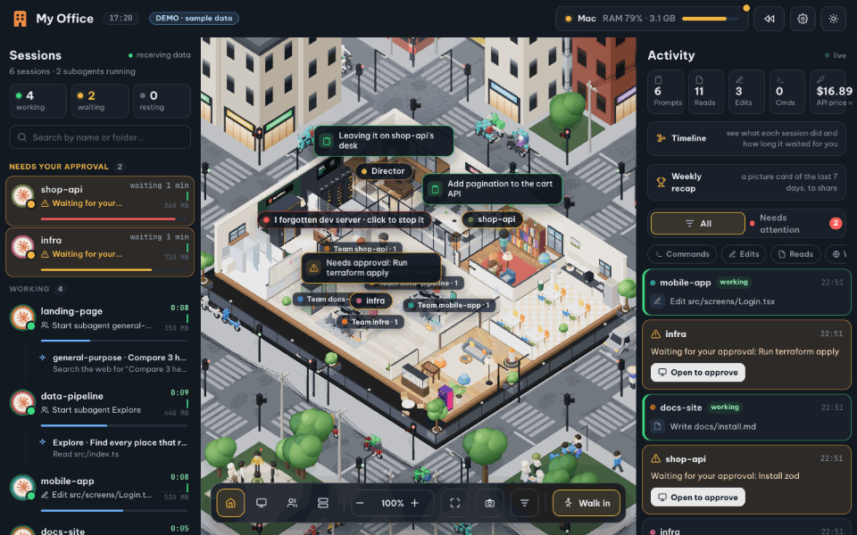

# 🏢 MyOffice-W-Antigravity — Văn phòng 3D Điều phối Multi-Agent cho Google Antigravity & Claude Code

[](https://github.com/Kettailor/MyOffice-W-Antigravity/actions/workflows/ci.yml)
[](https://kettailor.github.io/MyOffice-W-Antigravity/)
[](LICENSE)
[](package.json)

**Tiếng Việt** · [English](README.en.md) · [Kiến trúc Hệ thống](docs/ARCHITECTURE.md) · [Quy tắc Multi-Agent](AGENTS.md) · [Bảo mật](SECURITY.md) · [Đóng góp](CONTRIBUTING.md)

**MyOffice-W-Antigravity** là không gian văn phòng 3D trực quan theo thời gian thực (Three.js + Next.js + Node.js SSE Server), nơi mỗi phiên làm việc của **Google Antigravity** (và **Claude Code**) hóa thân thành một nhân vật Chibi 3D tại bàn làm việc riêng: tự động đọc tài liệu ở thư viện, gõ code tại bàn, chạy lệnh ở phòng server, triệu hồi đội ngũ **Subagent** nối dây nhóm trực quan, trình duyệt kế hoạch (`implementation_plan.md`) và bắn pháo hoa khi hoàn thành nhiệm vụ.



---

## 🙏 Tác giả Dự án Gốc & Ghi nhận Bản quyền (Credits & Attribution)

Dự án này được phát triển và mở rộng dựa trên nền tảng dự án mã nguồn mở gốc **[My Office (`khanh020905/my-office`)](https://github.com/khanh020905/my-office)**:

- **Tác giả dự án gốc (Original Author)**: **[@khanh020905](https://github.com/khanh020905)**
- **Kho lưu trữ gốc (Original Repository)**: **[https://github.com/khanh020905/my-office](https://github.com/khanh020905/my-office)** (*"Văn phòng 3D cho các phiên Claude Code · A 3D office for your Claude Code sessions"*)
- **Phát triển & Tích hợp hệ sinh thái Google Antigravity (`MyOffice-W-Antigravity`)**: **[@Kettailor](https://github.com/Kettailor)** — bổ sung bộ máy `Antigravity Brain Watcher` (`server/antigravity.mjs`), nhân tăng tốc **Rust Native Engine** (`rust-native/`) & **Docker On-Demand Host Bridge** (`server/host-bridge.mjs`), kiến trúc điều phối **Main Agent + 4 Subagents song song** (`AGENTS.md`), hộp thoại duyệt nổi **Focus-to-Approve** (`ask_question` & `implementation_plan.md`), bảng **Giao việc (chọn AI Model, lưu nháp 20 ảnh, đổi tên/ghim phiên) & Nhóm Chat 2 kênh tách biệt**, thống kê **Quota 5h/7d động** theo từng dự án/tài khoản, giám sát GPU NVIDIA trên Windows và hệ thống phân quyền bảo mật **HMAC-SHA256** cho **Phó Giám đốc (PIN 6 số) / Trợ lý Giám đốc** (`server/access.mjs`).
- **Trích dẫn kỹ thuật khác**:
  - Luật phát hiện tiến trình ngốn CPU/RAM và dev server bỏ quên trong `server/system.mjs` được tham khảo từ [Kanevry/cc-reaper](https://github.com/Kanevry/cc-reaper) (Apache-2.0).
  - Mô hình xe cộ trên đường phố sử dụng bộ [Kenney Car Kit 3.1](https://kenney.nl/assets/car-kit) (CC0).

> **Lưu ý**: Đây là dự án cộng đồng độc lập, không thuộc sở hữu hay đại diện chính thức của Google (Antigravity) hay Anthropic (Claude).

---

## ✨ Tính năng nổi bật

### 1. Tự động phát hiện & đồng bộ phiên Google Antigravity (`Brain Watcher`)
- Tự động quét thư mục `~/.gemini/antigravity/brain/<conversation-id>/.system_generated/logs/transcript.jsonl` mà không cần cấu hình thủ công.
- Mỗi cuộc hội thoại Antigravity đang mở là **một nhân vật Chibi 3D** có bàn làm việc riêng, biển tên phòng ban theo thư mục dự án (`Workspace`), hiển thị yêu cầu hiện tại và công cụ đang thực thi.
- Ánh xạ toàn bộ hệ công cụ của Antigravity sang hành động 3D sống động:
  | Công cụ Antigravity | Hành động trong Văn phòng 3D |
  | :--- | :--- |
  | `read_file`, `view_file_outline`, `list_dir` | Đọc tài liệu tại bàn / Giá sách thư viện |
  | `write_file`, `edit_file`, `multi_replace_file_content` | Gõ code tại bàn làm việc |
  | `run_command`, `manage_task`, `send_command_input` | Chạy lệnh tại Phòng Server / Terminal |
  | `grep_search`, `find_by_name` | Tra cứu hồ sơ tại Thư viện |
  | `search_web`, `read_url_content`, `search_marketplace` | Tra cứu thông tin trên Web |
  | `invoke_subagent`, `define_subagent`, `send_message` | Sinh nhân vật Chibi **Subagent** nối dây nhóm (`team-lines.js`) với Main Agent |
  | `ask_question`, `implementation_plan.md` (`RequestFeedback: true`) | Giơ tay xin ý kiến & bật hộp thoại duyệt nổi **Focus-to-Approve** |

### 2. Kiến trúc Điều phối Multi-Agent (`Main Agent` + `4 Subagents`) & Tốc độ Chibi Thích ứng
- Hỗ trợ hiển thị trực quan mô hình **Orchestrator (Tech Lead)** gọi song song 4 Subagent chuyên biệt (`world-3d-specialist`, `ui-chat-specialist`, `backend-agy-specialist`, `qa-test-specialist`).
- Khi Main Agent gọi `invoke_subagent`, thang máy được kích hoạt tức thì đưa nhân vật Chibi Subagent bước vào văn phòng, họp nhanh nhận việc từ Main Agent, di chuyển tới khu vực chuyên môn và báo cáo lại khi hoàn tất (kèm cơ chế hàng đợi hành động `deferMainAction` chống kẹt khi tác vụ hoàn thành nhanh).
- **Tốc độ di chuyển tùy biến thông minh (`calcPace`)**: Nhân vật Chibi đang trong phiên làm việc (`work` / `fire` / họp nhóm) tự động di chuyển nhanh nhạy để theo kịp các bước công cụ thời gian thực, và trở lại dáng đi bộ thư thái bình thường khi nghỉ ngơi (`rest`).

### 3. Đồng bộ Artifacts (`task.md`, `implementation_plan.md` & `walkthrough.md`)
- Tự động đọc checklist `- [ ]` / `- [/]` / `- [x]` từ file `task.md` trong thư mục brain của phiên và hiển thị trực tiếp trong ngăn kéo chi tiết của nhân vật.
- Khi Agent tạo hoặc cập nhật `implementation_plan.md` có bật `RequestFeedback`, hoặc gọi `ask_question`, giao diện tự động mở hộp thoại nổi giữa màn hình (**Focus-to-Approve**) giúp Giám đốc xem tóm tắt kế hoạch và chọn phương án trả lời ngay lập tức.

### 4. Hộp thoại `📋 Giao việc` Đa Mô hình, Quản lý Dự án & Bảng Kế hoạch 4 Chế độ
- **Giao việc nâng cao**: Hỗ trợ chọn **Mô hình AI (Model)** lưu riêng cho từng phiên/thư mục (`Gemini 4 Argon`, `Gemini 3.8 Flash`, `Claude Opus 5.5`, `Claude Sonnet 5.5`, `GPT-OSS 120B`), thêm dự án & tạo thư mục mới ngay trong mục **Cuộc trò chuyện mới**, loại bỏ dự án khỏi danh sách hiển thị mà không xóa thư mục gốc trên đĩa, ghim phiên/dự án (`📌`), đổi tên phiên (`✏️`), dừng/xóa phiên (`⏹️` / `🗑️`), và tự động lưu bản nháp kèm tối đa **20 ảnh** (`Ctrl+V` / `IndexedDB`).
- **Thanh Phiên làm việc gom theo Thư mục Dự án**: Tùy chọn gom nhóm các phiên làm việc theo thư mục dự án có thể đóng/mở gọn gàng, kèm giao diện thẻ phiên trực quan (chấm trạng thái phát sáng, badge số bước và thanh tiến độ).
- **Bảng Kế hoạch (`📋 Việc cần làm`) 4 Chế độ**: Phân chia **Xem tất cả**, **Việc của tôi** (lưu riêng trên từng thiết bị), **Việc của Agent** (tự động đồng bộ từ checklist `task.md`) và **Việc chung** (đồng bộ thời gian thực qua máy chủ cho mọi thiết bị kết nối).
- **Nhóm Chat tách kênh**: Tách biệt hoàn toàn kênh **💼 Nhóm Công Việc** (giao việc, duyệt lệnh, báo cáo tiến độ Antigravity) và **💬 Nhóm Tán Gẫu** (trò chuyện giải trí, trà sữa, ăn trưa), tự động dọn dẹp theo chu kỳ 7 ngày.

### 5. Phân quyền Truy cập Từ xa (`Phó Giám đốc` vs. `Trợ lý Giám đốc`), Quyền Điều khiển Phiên & Bảo mật `SHA-256 / HMAC`
- **Chính chủ Giám đốc (Thiết bị phụ / Điện thoại)**: Đăng nhập bằng **mã PIN 6 số** (băm `SHA-256` kèm salt, ký phiên bằng `HMAC-SHA256`) để nhận vai trò **Phó Giám đốc** (`isDirectorDevice: true`), có Phòng Đồng Giám đốc và toàn quyền quan sát/điều phối mọi dự án.
- **Trợ lý Giám đốc & Phân quyền Điều khiển Phiên (`sessionControl`)**: Đăng ký tên và vai trò qua trang cổng truy cập; Giám đốc có thể cấp/thu hồi quyền **Dừng, Sửa tên, Xóa phiên làm việc** ngay trên cả máy tính lẫn giao diện Điện thoại cho từng cộng tác viên hoặc theo mặc định toàn cục.

### 6. Kiến trúc Docker + Rust Native Engine + On-Demand Host Bridge & Giám sát Quota 5h/7d
- **Rust Native Engine (`rust-native/`)**: Tăng tốc quét thư mục Brain, đọc luồng `transcript.jsonl`, thu thập thông số hệ thống (`sysinfo`) và khiên bảo mật `SHA-256/HMAC` + `redact`.
- **Docker & On-Demand Host Bridge (`:4311`)**: Chạy gọn nhẹ trong Docker container (`:4310`) kết hợp trình giám sát `work-office-native watch-bridge` chỉ đánh thức Host Bridge khi có tác vụ thực thi và tự nghỉ sau 45 giây nhàn rỗi.
- Theo dõi thời gian thực CPU, RAM, ổ đĩa, GPU NVIDIA (`nvidia-smi`), tự động chuyển đổi đa tài khoản Antigravity và ước tính động hạn mức **Quota 5 giờ & 7 ngày** theo từng dự án.

### 7. Trung tâm Quản lý MCP (`🔌 MCP Hub`) & Trình Quản lý File Dự Án (`📁 File Dự Án`)
- **Trung tâm Kết nối & Quản lý MCP (`server/mcp.mjs` & `src/office/ui/mcp-drawer.js`)**: Quản lý tập trung toàn bộ máy chủ Model Context Protocol (`mcp_config.json`) với 4 tab chuyên biệt (**Danh sách Server**, **Kho 12 Mẫu MCP phổ biến**, **Form cấu hình tùy chỉnh `stdio`/`http` kèm Live JSON Preview**, và **Trình sửa/nhập/xuất JSON**). Hỗ trợ bật/tắt tức thời từng server hoặc toàn bộ, kiểm tra kết nối trực tiếp (`ping`), nhân bản cấu hình, khám phá danh sách tool/schema và tự động che khóa nhạy cảm (`maskSecret`).
- **Trình Quản lý & Xem File Dự Án (`server/files.mjs` & `src/office/ui/file-manager.js`)**: Duyệt cây thư mục theo đúng phân quyền Workspace, xem trực tiếp tài liệu Word (`.docx`), bảng tính Excel (`.xlsx`, `.csv`), `.pdf`, hình ảnh, video/audio, chỉnh sửa mã nguồn trực tuyến (`Ctrl+S`), tải file lên, tạo thư mục và giao việc trực tiếp kèm đường dẫn file.
- **Đổi nhanh AI Model & Thanh Chỉ thị Trực tiếp trong Ngăn Phiên (`Session Drawer`)**: Cho phép xem badge Model trên `Session Rail`, chuyển đổi trực tiếp giữa 14 AI Model (`Gemini 4 Argon`, `Gemini 3.8 Flash`, `Claude Opus 5.5`, `Claude Sonnet 5.5`, `GPT-OSS 120B`) và gửi chỉ thị nhanh (`#ds-quick-reply`) ngay trong ngăn chi tiết phiên.
- **Tùy chỉnh Giới tính Chibi 3D (`👦 Nam` / `👧 Nữ`)**: Hỗ trợ chọn giới tính nhân vật Chibi riêng cho Giám đốc, Phó Giám đốc (PIN) và từng Trợ lý Giám đốc.

---

## 🚀 Cài đặt & Sử dụng nhanh

### Yêu cầu hệ thống
- **Node.js**: `>= 20.9`
- **Hệ điều hành**: Windows, macOS hoặc Linux
- **Trình duyệt**: Hỗ trợ WebGL (Chrome, Edge, Safari, Firefox)

### Khởi chạy trong 1 phút

```bash
# 1. Clone kho lưu trữ
git clone https://github.com/Kettailor/MyOffice-W-Antigravity.git
cd MyOffice-W-Antigravity

# 2. Cài đặt dependencies
npm install

# 3. Chạy ngay chế độ phát triển (Turbopack + Hot Reload tại http://localhost:4310)
npm run dev
```

Mở trình duyệt tại **<http://localhost:4310>** để xem các phiên Antigravity thực tế trên máy của bạn, hoặc mở **<http://localhost:4310/?demo>** để trải nghiệm chế độ mô phỏng mà không cần cài đặt Agent.

### Chạy bằng Docker + On-Demand Host Bridge (Khuyên dùng trên Windows)

```bash
# Khởi chạy toàn bộ Docker container (:4310) + On-Demand Host Bridge (:4311)
npm run docker:up
# Hoặc nhấp đúp file Start-WorkOffice.bat trên Windows

# Kiểm tra trạng thái Docker, Host Bridge và Rust Native Engine
npm run docker:status

# Khởi động lại hoặc dừng hoàn toàn (hoặc chạy Stop-WorkOffice.bat)
npm run docker:restart
npm run docker:down
```

### Chạy bản Production (Standalone Node) & Cài đặt Dịch vụ nền

```bash
# Build bản production và khởi chạy server tại http://localhost:4310
npm run build
npm start

# Cài đặt hooks và dịch vụ khởi động cùng hệ điều hành
node bin/cli.mjs install --service

# Kiểm tra sức khỏe hệ thống (Node, Server, Hooks, Service)
node bin/cli.mjs doctor

# Xem hoặc tạo mới mã PIN 6 số cho thiết bị di động / Phó Giám đốc
node bin/cli.mjs pin
node bin/cli.mjs pin --new
```

| Lệnh CLI (`node bin/cli.mjs ...`) | Chức năng |
| :--- | :--- |
| `install [--service] [--lan] [--no-approve] [--no-status]` | Cài đặt hooks kết nối Agent và tùy chọn đăng ký dịch vụ chạy nền khi đăng nhập (`Startup` trên Windows, `launchd` trên macOS, `systemd` trên Linux). |
| `uninstall` | Gỡ bỏ toàn bộ hooks và dịch vụ nền, khôi phục nguyên trạng file cấu hình cũ. |
| `doctor` | Chẩn đoán trạng thái Node.js, cổng máy chủ `:4310`, hooks và dịch vụ nền. |
| `start [--lan]` | Build (nếu chưa có) và chạy máy chủ Production trong terminal hiện tại. |
| `pin [--new]` | Hiển thị mã PIN 6 số hiện tại; thêm `--new` để đổi mã PIN và đăng xuất các thiết bị từ xa. |

---

## 🤖 Luật Điều phối Multi-Agent (`AGENTS.md`)

Kho lưu trữ đi kèm quy chuẩn điều phối **Main Agent & 4 Subagent chuyên biệt** tại [`AGENTS.md`](AGENTS.md) và kỹ năng [`.agents/skills/multi-agent-orchestrator/SKILL.md`](.agents/skills/multi-agent-orchestrator/SKILL.md). Khi làm việc trên dự án này, các Subagent được phân vùng quyền ghi file tách biệt hoàn toàn để chạy song song không xung đột:

| Tên Subagent (`TypeName`) | Vai trò (`Role`) | Phạm vi thư mục được phép ghi (`Write Scope`) |
| :--- | :--- | :--- |
| **`world-3d-specialist`** | `3D World & Chibi Engineer` | `src/office/world/**`, `src/office/people/**`, `src/office/scene/**`, `src/office/core/**`, `src/office/life/**`, `src/office/audio/**` |
| **`ui-chat-specialist`** | `UI, Group Chat & i18n Engineer` | `src/office/ui/**`, `src/components/**`, `src/styles/**`, `src/shared/**`, `src/i18n/**` |
| **`backend-agy-specialist`** | `Backend & Antigravity Watcher Engineer` | `server/**` (`index.mjs`, `antigravity.mjs`, `access.mjs`, `tasks.mjs`, `system.mjs`, `platform/**`) |
| **`qa-test-specialist`** | `QA, Test & Build Verifier` | `tests/**` |

---

## 🔒 Luật Bảo mật & Dữ liệu Riêng tư (Privacy & Security Rules)

Dự án tuân thủ nghiêm ngặt nguyên tắc **Local-First & Zero-Leak** (chi tiết tại [`SECURITY.md`](SECURITY.md)):

1. **Không bao giờ đẩy dữ liệu cá nhân/nhạy cảm lên Git**:
   - Toàn bộ thư mục `data/` (`access.json`, `pin`, `token`, `chat.json`, `state.json`, `limits.json`, `projects.json`, `totals.json`, `replay/*.jsonl`, `shots/`, `task-images/`, `*.log`) cùng các file `.env*`, `*.key`, `*.pem`, `*.tsbuildinfo` đã được khóa chặt trong [`.gitignore`](.gitignore).
2. **Tự động che dấu khóa bí mật (`server/redact.mjs`)**:
   - Mọi chuỗi giống API Key, Bearer Token, GitHub Token (`ghp_...`), mật khẩu trong URL hoặc thông tin nhạy cảm đều được lọc qua `redact()` trước khi lưu log hoặc hiển thị lên giao diện.
3. **Cô lập Mạng & Kiểm soát Truy cập**:
   - Endpoint nhận hook chỉ chấp nhận kết nối từ chính máy cục bộ (`127.0.0.1` / `::1`).
   - Kết nối từ thiết bị ngoài chỉ hoạt động khi được bật chủ động qua mạng Wi-Fi tin cậy (`OFFICE_WIFI_SSID`) hoặc mạng riêng ảo **Tailscale** (`100.64.0.0/10`), bảo vệ bằng mã PIN 6 số có khóa chống dò mật khẩu (rate-limit lockout).
4. **An toàn Tiến trình**:
   - Mọi thao tác dọn dẹp tiến trình đều đối chiếu kép **PID + Thời điểm khởi chạy (`start time`)** để không bao giờ tắt nhầm tiến trình khác.

---

## 🧪 Kiểm thử & CI/CD

Dự án được trang bị hệ thống **GitHub Actions CI/CD** tự động trong `.github/workflows/`:
- **[`ci.yml`](.github/workflows/ci.yml)**:
  - Kiểm tra ESLint (`npm run lint`), TypeScript (`npm run typecheck`), 27+ bài kiểm thử đơn vị (`npm test`), đồng bộ bản đồ kiến trúc (`node scripts/module-map.mjs --check`) và build Next.js trên **Node.js 20 & 22**.
  - Chạy kiểm thử đa nền tảng (`npm run smoke`) trên cả 3 hệ điều hành: **Ubuntu Linux**, **Windows** và **macOS**.
  - Chạy kiểm thử trình duyệt thực tế đầu-cuối với **Playwright** (`npm run test:e2e:smoke`).
- **[`pages.yml`](.github/workflows/pages.yml)**:
  - Tự động đóng gói bản tĩnh đa ngôn ngữ (`scripts/build-demo.mjs`) và xuất bản lên **GitHub Pages** sau mỗi lần cập nhật nhánh `main`.

```bash
# Chạy toàn bộ bộ kiểm tra chất lượng trước khi commit
npm run lint
npm run typecheck
npm test
node scripts/module-map.mjs --check
npm run build
npm run smoke
```

---

## 📂 Cấu trúc Thư mục

```text
MyOffice-W-Antigravity/
├── .agents/skills/          # Kỹ năng điều phối Multi-Agent cho Antigravity
├── .github/                 # Workflows CI/CD (ci.yml, pages.yml) & Issue/PR Templates
├── app/                     # Next.js App Router (layout, page, icons, metadata)
├── bin/                     # Công cụ CLI (cli.mjs, service.mjs)
├── docs/                    # Tài liệu kiến trúc (ARCHITECTURE.md) & ảnh minh họa
├── hooks/                   # Hooks chuyển tiếp sự kiện & status-line
├── public/                  # Tài sản 3D, текстура, phương tiện giao thông, âm thanh
├── rust-native/             # Nhân tăng tốc Rust Native (Axum, Tokio, sysinfo, SHA-256/HMAC)
├── scripts/                 # Điều phối Docker (docker-ctl.mjs), build demo, smoke test, module map
├── server/                  # Máy chủ HTTP/SSE, Brain Watcher (antigravity.mjs), Host Bridge, Phân quyền
├── src/
│   ├── components/          # Các thành phần giao diện React (TopBar, Stage, Drawers...)
│   ├── i18n/                # Từ điển đa ngôn ngữ đồng bộ (Tiếng Việt & Tiếng Anh)
│   ├── office/              # Engine văn phòng 3D (Three.js: world, people, scene, ui, life...)
│   ├── shared/              # Bộ máy Nhóm Chat 2 kênh (chat-engine.js)
│   └── styles/              # Hệ thống CSS theo từng phân vùng giao diện
├── tests/                   # Unit tests (node --test) & E2E tests (Playwright)
├── Dockerfile               # Multi-stage build (Rust Alpine + Node 22 Alpine)
├── docker-compose.yml       # Cấu hình chạy container work-office & kết nối Host Bridge
├── Start-WorkOffice.bat     # Trình khởi chạy nhanh 1 chạm trên Windows
├── Stop-WorkOffice.bat      # Trình dừng nhanh Docker & Host Bridge trên Windows
├── AGENTS.md                # Luật điều phối Main Agent & 4 Subagent chuyên biệt
├── CODE_OF_CONDUCT.md       # Quy tắc ứng xử cộng đồng
├── CONTRIBUTING.md          # Hướng dẫn đóng góp mã nguồn
├── LICENSE                  # Giấy phép MIT (khanh020905 & Kettailor)
└── SECURITY.md              # Chính sách bảo mật & báo cáo lỗ hổng
```

---

## 📄 Giấy phép (License)

Phát hành dưới giấy phép **[MIT License](LICENSE)**.
- Bản quyền gốc © 2026 **[khanh020905](https://github.com/khanh020905)** ([`khanh020905/my-office`](https://github.com/khanh020905/my-office)).
- Bản quyền mở rộng & tích hợp Antigravity © 2026 **[Kettailor](https://github.com/Kettailor)** ([`Kettailor/MyOffice-W-Antigravity`](https://github.com/Kettailor/MyOffice-W-Antigravity)).
